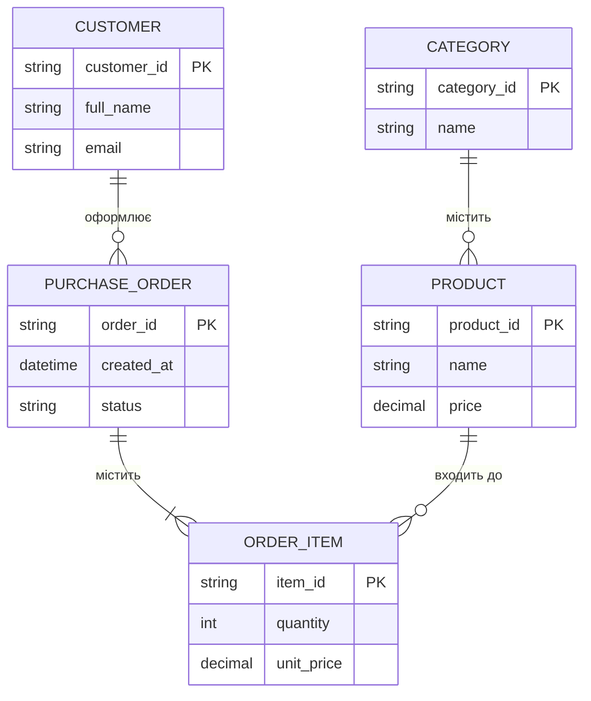

# Завдання 1 — ER-модель інтернет-магазину

## Опис

Цей проєкт містить ER-модель простого інтернет-магазину.
У моделі показано покупців, товари, категорії та замовлення.

## Перша версія ER-діаграми

## Примітка

Це початкова версія діаграми, запропонована за допомогою AI.
Модель потрібно перевірити на відповідність файлу spec.md.